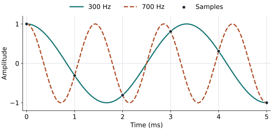

信号发生器输出 700 Hz 的单音。采集器每秒读 1000 次，软件用这 1000 个读数画出单边幅度谱，峰却落在 300 Hz。先别调频谱窗口：即使采集器毫无噪声，每个读数都无限精确，同一列数字也能由一个真正的 300 Hz 单音产生。

## 两条曲线怎样穿过同一组点

让两个余弦波都从波峰起步，振幅都取 1。300 Hz 的波每毫秒走过 0.3 圈，700 Hz 的波每毫秒走过 0.7 圈。在第 0.5 毫秒，前者的振幅约为 0.588，后者约为 −0.588，一正一负，很容易区分。偏偏采集器只在整毫秒读数。

横轴是时间，纵轴是归一化振幅。图中的线表示两种可能的模拟输入，黑点才是采集器交给软件的数据。前六个读数依次约为 1、−0.309、−0.809、0.809、0.309、−1。只保留黑点，就丢掉了刚才能区分两条曲线的半毫秒位置。

这个巧合会持续多久？把采样率记作 $f_s$，频率记作 $f$。第 $n$ 个读数对应时刻 $n/f_s$ 秒，其中 $n$ 是从 0 开始的整数。把频率换成 $f_s-f$，该时刻的读数为

$$
\cos\!\left(2\pi(f_s-f)\frac{n}{f_s}\right)
=\cos\!\left(2\pi n-2\pi f\frac{n}{f_s}\right)
=\cos\!\left(2\pi f\frac{n}{f_s}\right).
$$

第一步把相位拆成整数圈和一个反向转角。整数圈不改变位置，余弦又恰好对正负转角取相同的值。这就解释了全部采样点为何重合。即使初相位未知，频率为 $f$、相位为 $\phi$ 的余弦，也有一个频率为 $f_s-f$、相位为 $-\phi$ 的对应波形。不同输入留下相同记录，就是**混叠**。

## 怎样算出频谱峰落在哪里

在采样点上，每毫秒再多转一整圈，读数还是一样。因此频率除了可以反向，还可以加减采样率的整数倍。对实值单音，要找它在单边谱上的位置，可以找出它到最近的采样率整数倍的距离。以 $f_s=1000$ Hz 为例：

| 输入频率 | 最近的采样率整数倍 | 单边谱中的频率 |
| --- | --- | --- |
| 300 Hz | 0 Hz | 300 Hz |
| 700 Hz | 1000 Hz | 300 Hz |
| 1300 Hz | 1000 Hz | 300 Hz |
| 1700 Hz | 2000 Hz | 300 Hz |

这个距离最多是采样率的一半。于是 0 到 500 Hz 就能容下这套采样数据中所有可区分的实值单音频率，500 Hz 称为奈奎斯特频率。看到 300 Hz 的峰，可以判断样本以怎样的节奏变化；要判断输入原来是哪一行，还得知道采集前允许哪些频率进入。[Analog Devices 的采样教程](https://www.analog.com/media/en/training-seminars/tutorials/mt-002.pdf)给出了不同频带折回同一位置的频谱图。

边界上的 500 Hz 也值得单独看。若它从波峰开始，样本在 1 和 −1 之间交替；若它从零点开始，采集器每次都赶上过零，整列读数就是 0。对于从直流开始、相位未知且希望完整保留的信号，应让最高目标频率严格低于采样率的一半。

## 在哪一步还能把两个频率分开

假设目标是测量 0 到 300 Hz 的振动，附近还可能有一个很强的 700 Hz 干扰。若继续以 1000 Hz 直接采样，应在模拟输入端加低通滤波器，让 300 Hz 通过，同时把 700 Hz 衰减到测量误差允许的水平。滤波器要有从通带到阻带的过渡空间，设计时既要看目标频带的边缘，也要看带外干扰有多强。[抗混叠滤波器设计说明](https://www.analog.com/en/resources/technical-articles/guide-to-antialiasing-filter-basics.html)讨论了这两项如何影响滤波要求。

若硬件能以 2000 Hz 采集，事情就不同了。在这个采样率下，300 Hz 和 700 Hz 都低于 1000 Hz，采集器还保留着图中半毫秒处的不同读数。要输出每秒 1000 个样本，可以先在高采样率数据上做数字低通，保留目标频带并充分抑制会折入其中的成分，再每隔一个点取一个。顺序一旦颠倒，第一步丢掉的恰好就是能区分这两个单音的点。采用较高采样率时，模拟输入仍须限制会在第一次采样时混叠进目标频带的成分。

如果手里只剩最初每秒 1000 点的记录，延长采集时间可以改善相近频率的分辨能力，却不能拆开这对完全重合的样本。要追查峰的来源，可以在输入稳定时把采样率改成 1200 Hz 再录一次。真正的 300 Hz 仍落在 300 Hz，700 Hz 会移到 500 Hz。这个对照能区分开头的两个候选；若输入频率范围完全未知，还需结合前端带宽继续缩小范围。
